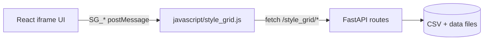

# Backend API Reference

Base URL: `http://127.0.0.1:7860/style_grid`

Gradio/FastAPI. All endpoints return HTTP 200 even on errors unless otherwise noted. Check response body for `{error}` field.

## V2 Integration Notes

Forgeventory V2 UI (React iframe) communicates with the host script via `postMessage` (`SG_*` types in `ui/src/bridge.ts`), then the host calls these API routes. The iframe document is loaded via **GET `/style_grid/ui`** (see **GET /ui**). The host keeps **two** `message` listeners (txt2img and img2img iframes); handlers should only act when `event.source === <that tab’s iframe>.contentWindow` so a message from one frame is not applied to the wrong tab.

Thumbnail **image** requests use `GET /style_grid/thumbnail?name=…`. The server resolves the file on disk without using query `source`: it tries the legacy name-only hash first, then source-aware paths derived from cached styles (see **GET /thumbnail**). The React/host UI may still append `source` and `v` for cache behavior; they are not used for routing. **Generation** disambiguation uses `source` in **`POST /style_grid/thumbnail/generate`** (JSON body), not the GET query string.

The API contract in this document reflects `stylegrid/routes.py` (registered from `scripts/style_grid.py`).

## GET /ui

**Method:** GET  
**Description:** Serves the V2 React shell HTML from `ui/dist/index.html`. Implementation: **`_get_ui_html()`** in `stylegrid/routes.py` transforms the file so **every** relative asset reference (`src` / `href` with a `./…` path) is rewritten to Gradio static URLs under `/file=extensions/<installed-folder>/ui/dist/…`, using the actual extension directory name, with a **fresh** cache-busting `?v=<unix time>` on **each** response (scripts, stylesheets, favicon, etc.). The host iframe uses this route (e.g. `GET /style_grid/ui?t=<timestamp>`) instead of loading the file via `/file=…/index.html` alone, so the HTML document and **all** linked assets stay fresh after rebuilds.

**Parameters:** Optional query on the iframe URL (e.g. `t`) is for browser cache busting of the **document** request; the handler does not parse preset names from the query.

**Response:** `text/html`

**Error cases:** If `ui/dist/index.html` is missing (UI not built), the server may return an error response.

## Generation-time: `{sg:…}` wildcards

This is **not** an HTTP API. During each generation, `scripts/style_grid.py` runs `resolve_sg_wildcards` from `stylegrid/wildcards.py` over the positive and negative prompt strings.

| Topic | Behavior |
|---|---|
| Syntax | `{sg:<category>}` — matched by regex `\{sg:([^}]+)\}`. |
| Lookup | Token category is lowercased; map key is lowercased category from loaded styles. |
| Replacement | One random style in that category; inserts that style’s CSV **`prompt`** field. |
| No match | Original `{sg:…}` text is kept. |

The Styles sidebar can also build a session-only pool from arbitrary selected cards. The host stores the selected style names under a short token such as `{sg:temp-1}` and passes the pool through the hidden script input for the active Forge tab. Resolution chooses one member through the active source sheet, so its positive and negative fields stay aligned without creating a wildcard file.

**Compatibility:** Automatic1111-style wildcard extensions (e.g. file-based **`__wildcard__`** tokens) use **different** syntax. They do not consume `{sg:…}` and Forgeventory does not consume `__…__` — no mandatory conflict. **`{sg:…}` does not require** installing external wildcard extensions; it is self-contained in this extension.

## Styles

## GET /styles

**Method:** GET  
**Description:** Returns categorized styles and usage counters, with ETag support.

**Parameters:**

| name            | in     | required | type   | description                       |
| --------------- | ------ | -------- | ------ | --------------------------------- |
| `If-None-Match` | header | No       | string | ETag value for conditional fetch. |

**Response:**

| field        | type   | description                                     |
| ------------ | ------ | ----------------------------------------------- |
| `categories` | object | Map of category name -> array of style objects. |
| `usage`      | object | Per-style usage stats map.                      |

Style object fields include:

| field               | type    | description                                                 |
| ------------------- | ------- | ----------------------------------------------------------- |
| `name`              | string  | Style name from CSV.                                        |
| `prompt`            | string  | Positive prompt fragment.                                   |
| `negative_prompt`   | string  | Negative prompt fragment.                                   |
| `description`       | string  | Freeform description.                                       |
| `category_explicit` | string  | Raw category column value from CSV.                         |
| `organizer_tags`    | array[string] | Organizer-only labels used for Style filtering and batch editing. |
| `source_file`       | string  | Source CSV filename/path as provided by loader.             |
| `category`          | string  | Resolved category.                                          |
| `display_name`      | string  | Display label derived from name.                            |
| `has_placeholder`   | boolean | True if `{prompt}` is present in prompt or negative prompt. |

**Error cases:**

| case                         | behavior                           |
| ---------------------------- | ---------------------------------- |
| Cache hit with matching ETag | Returns HTTP `304` and empty body. |

## POST /reload

**Method:** POST  
**Description:** Forces style cache reload and returns fresh categorized data.

**Parameters:**

| name   | in   | required | type   | description          |
| ------ | ---- | -------- | ------ | -------------------- |
| (none) | body | No       | object | Empty body accepted. |

**Response:**

| field        | type   | description            |
| ------------ | ------ | ---------------------- |
| `categories` | object | Reloaded category map. |
| `usage`      | object | Current usage map.     |

**Error cases:** None explicitly returned as `{error}`.

## GET /check_update

**Method:** GET  
**Description:** Returns whether any tracked CSV files changed.

**Parameters:**

| name   | in    | required | type | description    |
| ------ | ----- | -------- | ---- | -------------- |
| (none) | query | No       | -    | No parameters. |

**Response:**

| field     | type    | description                         |
| --------- | ------- | ----------------------------------- |
| `changed` | boolean | True if CSV set or content changed. |

**Error cases:** None explicitly returned as `{error}`.

## GET /usage

**Method:** GET  
**Description:** Returns usage statistics storage as-is.

**Parameters:**

| name   | in    | required | type | description    |
| ------ | ----- | -------- | ---- | -------------- |
| (none) | query | No       | -    | No parameters. |

**Response:**

| field          | type   | description                                                                     |
| -------------- | ------ | ------------------------------------------------------------------------------- |
| `<style_name>` | object | Dynamic keys; each value typically includes `count`, `last_used`, `first_used`. |

**Error cases:** None explicitly returned as `{error}`.

## POST /usage/increment

**Method:** POST  
**Description:** Increments usage counters for the provided style names.

**Parameters:**

| name     | in   | required | type          | description                                                  |
| -------- | ---- | -------- | ------------- | ------------------------------------------------------------ |
| `styles` | body | No       | array[string] | Style names to increment; defaults to empty list if omitted. |

**Response:**

| field | type    | description                            |
| ----- | ------- | -------------------------------------- |
| `ok`  | boolean | Always `true` after handler execution. |

**Error cases:** None explicitly returned as `{error}`.

## GET /preferences

**Method:** GET
**Description:** Loads Forgeventory's private server-backed UI preferences from `data/ui_preferences.json`. The response reports whether a valid file already exists so the React UI can migrate its former browser-only values once.

**Response:**

| field | type | description |
|---|---|---|
| `initialized` | boolean | `true` when a valid preferences file was loaded. |
| `preferences` | object | Normalized compact/grouped display, favorites, recents, source, category-order, and multi-select preferences. |

## POST /preferences

**Method:** POST
**Description:** Merges supported preference fields into `data/ui_preferences.json`. Values are type-checked and bounded, unsupported fields are discarded, and the file is replaced atomically.

**Body:** Any subset of `compact_mode`, `group_by_category`, `favorites`, `recent_names`, `active_source`, `category_order`, `style_multi_select`, `style_tag_multi_select`, `preset_multi_select`, and `lora_multi_select`.

**Response:** `{ "ok": true, "preferences": { ... } }` with the complete normalized state.

## POST /conflicts

**Method:** POST  
**Description:** Computes prompt/negative token conflicts for selected styles.

**Parameters:**

| name     | in   | required | type          | description                                     |
| -------- | ---- | -------- | ------------- | ----------------------------------------------- |
| `styles` | body | No       | array[string] | Style names to analyze; defaults to empty list. |

**Response:**

| field       | type          | description                |
| ----------- | ------------- | -------------------------- |
| `conflicts` | array[object] | Detected conflict entries. |

Conflict item fields:

| field     | type          | description                               |
| --------- | ------------- | ----------------------------------------- |
| `styles`  | array[string] | Two style names involved in the conflict. |
| `type`    | string        | Currently `positive_vs_negative`.         |
| `tokens`  | array[string] | Overlapping token sample (up to 5).       |
| `message` | string        | Human-readable conflict summary.          |

**Error cases:** None explicitly returned as `{error}`.

## Presets

## GET /presets

**Method:** GET  
**Description:** Returns all saved presets.

**Parameters:**

| name   | in    | required | type | description    |
| ------ | ----- | -------- | ---- | -------------- |
| (none) | query | No       | -    | No parameters. |

**Response:**

| field           | type   | description                                    |
| --------------- | ------ | ---------------------------------------------- |
| `<preset_name>` | object | Dynamic keys; each value includes preset data. |

Preset object fields:

| field     | type          | description                        |
| --------- | ------------- | ---------------------------------- |
| `styles`  | array[string] | Selected style names in preset.    |
| `created` | string        | Timestamp (`YYYY-MM-DDTHH:MM:SS`). |

**Error cases:** None explicitly returned as `{error}`.

## POST /presets/save

**Method:** POST  
**Description:** Saves or updates a preset name with a style list.

**Parameters:**

| name     | in   | required | type          | description                 |
| -------- | ---- | -------- | ------------- | --------------------------- |
| `name`   | body | Yes      | string        | Preset name (trimmed).      |
| `styles` | body | No       | array[string] | Styles list for the preset. |

**Response:**

Success:

| field     | type    | description               |
| --------- | ------- | ------------------------- |
| `ok`      | boolean | `true` on success.        |
| `presets` | object  | Full updated presets map. |

**Error cases:**

| case                 | response body                  |
| -------------------- | ------------------------------ |
| Missing/empty `name` | `{ "error": "Name required" }` |

## POST /presets/delete

**Method:** POST  
**Description:** Deletes a preset by name if it exists.

**Parameters:**

| name   | in   | required | type   | description            |
| ------ | ---- | -------- | ------ | ---------------------- |
| `name` | body | No       | string | Preset name to remove. |

**Response:**

| field     | type    | description                              |
| --------- | ------- | ---------------------------------------- |
| `ok`      | boolean | `true` on completion.                    |
| `presets` | object  | Full presets map after deletion attempt. |

**Error cases:** None explicitly returned as `{error}`.

## Thumbnails

## GET /loras

**Description:** Recursively lists `.safetensors`, `.ckpt`, and `.pt` files from Forge's primary and additional configured LoRA roots. Responses contain opaque ids, relative paths, local organizer categories, sidecar availability, and Forge's saved activation text, preferred/effective weight, and negative prompt. The `token` field contains the effective weighted LoRA token, while `prompt` combines that token with activation text. Absolute paths are never returned.

## POST /loras/categories

**Description:** Replaces the local multi-category assignment for one opaque LoRA id. Categories are saved in ignored runtime file `data/lora_tags.json`.

## GET /lora-preview

**Description:** Streams an existing same-basename or `.preview` image sidecar for an opaque LoRA id. The route resolves the id against configured LoRA roots and never accepts an arbitrary filesystem path.

## GET /thumbnails/list

**Method:** GET  
**Description:** Returns style names that currently have a thumbnail file.

**Parameters:**

| name   | in    | required | type | description    |
| ------ | ----- | -------- | ---- | -------------- |
| (none) | query | No       | -    | No parameters. |

**Response:**

| field           | type          | description                                |
| --------------- | ------------- | ------------------------------------------ |
| `has_thumbnail` | array[string] | Style names with existing thumbnail files. |

**Error cases:** None explicitly returned as `{error}`.

## GET /thumbnail

**Method:** GET  
**Description:** Returns a single cached thumbnail image. On-disk filenames are derived from an MD5 of `style_name` and, when present, the style’s CSV path (see `stylegrid/thumbnails.py` — `source_file` participates in the hash).

**Resolution (server):**

1. If `get_thumbnail_path(name)` exists on disk, that file is returned (legacy name-only hash).
2. Otherwise, the handler collects all rows in `get_cached_styles()` with `name` equal to the query `name`, iterates them in **reverse** order (last cached occurrence first), and for each row builds `get_thumbnail_path(name, source_file)`; duplicate paths are skipped. The **first** path that exists on disk is returned.

This matches how thumbnails are stored after generation or upload when a source-aware hash is used. Clients may add extra query parameters (for example `source` or `v`); the handler **only** uses `name` for lookup.

**Parameters:**

| name   | in    | required | type   | description |
| ------ | ----- | -------- | ------ | ----------- |
| `name` | query | Yes      | string | Style name (same as in `/styles`). |
| (other) | query | No       | string | Ignored for file resolution (e.g. cache-busting `v`, legacy `source`). |

**Response:**

| type                | description                     |
| ------------------- | ------------------------------- |
| `image/webp` binary | Thumbnail file body when found. |

**Error cases:**

| case              | behavior                                 |
| ----------------- | ---------------------------------------- |
| Thumbnail missing | Returns HTTP `404` (not JSON `{error}`). |

## POST /thumbnail/upload

**Method:** POST  
**Description:** Uploads a base64-encoded image as a style thumbnail.

**Parameters:**

| name    | in   | required | type   | description                        |
| ------- | ---- | -------- | ------ | ---------------------------------- |
| `name`  | body | Yes      | string | Style name to attach thumbnail to. |
| `image` | body | Yes      | string | Base64 payload (raw or data URL).  |

**Response:**

Success:

| field | type    | description                    |
| ----- | ------- | ------------------------------ |
| `ok`  | boolean | `true` after successful write. |

**Error cases:**

| case                       | response body                                                        |
| -------------------------- | -------------------------------------------------------------------- |
| Missing `name` or `image`  | `{ "error": "name and image required" }`                             |
| File too large (>2MB)      | `{ "error": "Image too large (max 2MB)" }`                           |
| Unsupported file signature | `{ "error": "Invalid image format. Allowed: JPEG, PNG, WEBP, GIF" }` |
| Unexpected exception       | `{ "error": "<exception message>" }`                                 |

## GET /thumbnail/gen_status

**Method:** GET  
**Description:** Returns generation state for a style thumbnail job.

**Parameters:**

| name   | in    | required | type   | description                              |
| ------ | ----- | -------- | ------ | ---------------------------------------- |
| `name` | query | No       | string | Style name key in generation status map. |

**Response:**

| field     | type   | description                                                 |
| --------- | ------ | ----------------------------------------------------------- |
| `status`  | string | `idle`, `running`, `done`, or `error` (depending on state). |
| `message` | string | Present on `error` states.                                  |

**Error cases:** None explicitly returned as `{error}` by this endpoint.

## POST /thumbnail/generate

**Method:** POST  
**Description:** Starts asynchronous SD thumbnail generation for a style.

**Parameters:**

| name     | in   | required | type   | description |
| -------- | ---- | -------- | ------ | ----------- |
| `name`   | body | Yes      | string | Style name to generate thumbnail for. |
| `source` | body | No       | string | When set and not `All`, selects the cached style row whose `name` matches and whose `source` or `source_file` equals this string (disambiguates duplicate names across CSVs). If omitted or unmatched, the first row by the usual name map is used. |

**Response:**

Success:

| field    | type    | description                  |
| -------- | ------- | ---------------------------- |
| `ok`     | boolean | `true` when job starts.      |
| `status` | string  | `running` on accepted start. |

**Error cases:**

| case                          | response body                                                            |
| ----------------------------- | ------------------------------------------------------------------------ |
| Missing/empty `name`          | `{ "error": "name required" }`                                           |
| SD busy                       | `{ "error": "SD is busy, try again after current generation finishes" }` |
| Already generating same style | `{ "error": "already generating" }`                                      |

## POST /thumbnails/cleanup

**Method:** POST  
**Description:** Removes orphaned thumbnail files not matching any current style.

**Parameters:**

| name   | in   | required | type   | description          |
| ------ | ---- | -------- | ------ | -------------------- |
| (none) | body | No       | object | Empty body accepted. |

**Response:**

| field     | type    | description                               |
| --------- | ------- | ----------------------------------------- |
| `removed` | integer | Number of deleted orphan thumbnail files. |

**Error cases:** None explicitly returned as `{error}`.

## CRUD

## POST /style/save

**Method:** POST  
**Description:** Creates or updates one style row in a target CSV.

**Parameters:**

| name              | in   | required | type   | description                                   |
| ----------------- | ---- | -------- | ------ | --------------------------------------------- |
| `name`            | body | Yes      | string | Style name (trimmed).                         |
| `prompt`          | body | No       | string | Positive prompt content.                      |
| `negative_prompt` | body | No       | string | Negative prompt content.                      |
| `description`     | body | No       | string | Description text.                             |
| `source`          | body | No       | string | Source CSV filename (with or without `.csv`). |
| `category`        | body | No       | string | Explicit structural category.                 |
| `organizer_tags`  | body | No       | array[string] | Organizer-only Style tags.                 |

**Response:**

| field | type    | description        |
| ----- | ------- | ------------------ |
| `ok`  | boolean | `true` after save. |

**Error cases:**

| case                 | response body                  |
| -------------------- | ------------------------------ |
| Missing/empty `name` | `{ "error": "Name required" }` |

## POST /styles/categories/batch

**Method:** POST
**Description:** Moves selected Style rows to one explicit category while preserving their names, prompts, descriptions, and source CSV files. Each item is resolved against its exact existing source path.

**Parameters:**

| name | in | required | type | description |
|---|---|---|---|---|
| `styles` | body | Yes | array[object] | Selected rows as `{ "name": string, "source": string }`; maximum 5,000. |
| `category` | body | Yes | string | New explicit category, 1-100 characters after trimming. |

**Response:** `{ "ok": true, "updated": <count>, "category": "<category>" }`.

**Error cases:** Empty selections, excessive selections, missing/long category names, or rows that cannot be found return an `{error}` field.

## POST /styles/tags/batch

**Method:** POST
**Description:** Adds and removes organizer tags from selected Style rows while preserving mixed values. For recognized `Natural Language` and `Tags` source names, the same change is applied to the matching row in both prompt-format sheets.

| name | in | required | type | description |
|---|---|---|---|---|
| `styles` | body | Yes | array[object] | Selected rows as `{ "name": string, "source": string }`; maximum 5,000. |
| `add_categories` | body | No | array[string] | Tags to add. |
| `remove_categories` | body | No | array[string] | Tags to remove. |
| `organizer_tags` | body | No | array[string] | Complete replacement used when no add/remove patch is supplied. |

**Response:** `{ "ok": true, "updated": <selected-style-count>, "updated_rows": <physical-row-count>, ... }`.

## POST /styles/tags/rename

**Method:** POST
**Description:** Renames one organizer tag case-insensitively everywhere it is assigned in loaded Style CSVs.

| name | in | required | type | description |
|---|---|---|---|---|
| `tag` | body | Yes | string | Existing tag. |
| `new_name` | body | Yes | string | Replacement tag. |

**Response:** `{ "ok": true, "updated": <physical-row-count>, "tag": "<new-name>" }`.

## POST /style/delete

**Method:** POST  
**Description:** Deletes one style row by name from the selected source (or inferred source).

**Parameters:**

| name     | in   | required | type   | description               |
| -------- | ---- | -------- | ------ | ------------------------- |
| `name`   | body | Yes      | string | Style name to delete.     |
| `source` | body | No       | string | Source CSV filename hint. |

**Response:**

| field | type    | description                  |
| ----- | ------- | ---------------------------- |
| `ok`  | boolean | `true` after delete attempt. |

**Error cases:**

| case                 | response body                  |
| -------------------- | ------------------------------ |
| Missing/empty `name` | `{ "error": "Name required" }` |

## POST /backup

**Method:** POST  
**Description:** Creates a timestamped backup of styles CSV files returned by `get_all_styles_file_paths()`. Paths that are not regular files on disk are **skipped** (no error — missing optional files do not abort the run).

**Parameters:**

| name   | in   | required | type   | description          |
| ------ | ---- | -------- | ------ | -------------------- |
| (none) | body | No       | object | Empty body accepted. |

**Response:**

Success (at least one file copied):

| field | type    | description |
| ----- | ------- | ----------- |
| `ok`  | boolean | `true`.     |

No files copied (all paths missing or list empty):

| field | type    | description |
| ----- | ------- | ----------- |
| `ok`  | boolean | `false`.    |

On unexpected failure while copying (exception in `backup_csv_files()`):

| field   | type   | description                    |
| ------- | ------ | ------------------------------ |
| `error` | string | Exception message as a string. |

**Error cases:**

| case                         | response body                          |
| ---------------------------- | -------------------------------------- |
| Exception during backup I/O  | `{ "error": "<message>" }` (HTTP 200). |

The host UI (`SG_BACKUP` in `javascript/style_grid.js`) should treat `{ "error": … }`, `{ "ok": false }`, non-success HTTP status, and network/parse errors and show a toast — it does not assume JSON-only success.

## GET /export

**Method:** GET  
**Description:** Exports styles, presets, usage, and export timestamp.

**Parameters:**

| name   | in    | required | type | description    |
| ------ | ----- | -------- | ---- | -------------- |
| (none) | query | No       | -    | No parameters. |

**Response:**

| field         | type          | description                            |
| ------------- | ------------- | -------------------------------------- |
| `styles`      | array[object] | Flat list from all loaded CSV sources. |
| `presets`     | object        | Presets map.                           |
| `usage`       | object        | Usage map.                             |
| `exported_at` | string        | Timestamp (`YYYY-MM-DDTHH:MM:SS`).     |

**Error cases:** None explicitly returned as `{error}`.

## POST /import

**Method:** POST  
**Description:** Imports presets into storage and optionally writes imported styles into a new CSV file.

**Parameters:**

| name      | in   | required | type          | description                                                 |
| --------- | ---- | -------- | ------------- | ----------------------------------------------------------- |
| `presets` | body | No       | object        | Preset map merged into existing presets.                    |
| `styles`  | body | No       | array[object] | Styles to write into `styles/imported_YYYYMMDD_HHMMSS.csv`. |

**Response:**

| field | type    | description           |
| ----- | ------- | --------------------- |
| `ok`  | boolean | `true` on completion. |

**Error cases:** None explicitly returned as `{error}`.

## GET /share/style

**Method:** GET
**Description:** Exports one Style as a portable `.forgeventory` ZIP package. Matching Natural Language and Tags rows from the same source family are included together. The first available source-aware WebP thumbnail is embedded as `preview.webp`.

| name | in | required | type | description |
| --- | --- | --- | --- | --- |
| `name` | query | Yes | string | Exact Style name. |
| `source` | query | No | string | Source CSV path or basename used to select the intended duplicate and its paired format. |

**Response:** Binary `application/vnd.forgeventory.item+zip` attachment containing `manifest.json` and, when available, `preview.webp`.

**Error cases:** HTTP `422` when the Style cannot be found or the package cannot be created.

## GET /share/preset

**Method:** GET
**Description:** Exports one preset as a portable `.forgeventory` package. Style-list presets are resolved into standalone positive and negative prompt text; the package never contains references that require the recipient to own matching Styles. An assigned WebP preview is embedded when available.

| name | in | required | type | description |
| --- | --- | --- | --- | --- |
| `name` | query | Yes | string | Exact preset name. |
| `source` | query | No | string | Active Style source used while flattening a Style-list preset. |

**Response:** Binary `application/vnd.forgeventory.item+zip` attachment.

**Error cases:** HTTP `404` when the preset is missing; HTTP `422` when a referenced Style is unavailable or the package cannot be created.

## POST /share/inspect

**Method:** POST
**Description:** Validates a shared-item package and returns safe metadata for the import dialog without writing library files. Absolute sender and recipient paths are never returned.

| name | in | required | type | description |
| --- | --- | --- | --- | --- |
| `package` | body | Yes | string | Base64 package bytes, optionally as a browser data URL. |

**Response:** Common fields are `kind`, `name`, `description`, and `has_preview`. Style responses also include prompt formats, local destination collections, category/tag suggestions, and existing local categories/tags. Preset responses include category suggestions, existing local categories, and a name-conflict flag.

**Error cases:** HTTP `422` for invalid Base64, an unsupported schema/version, malformed metadata, unsupported ZIP members, or package/manifest/preview size violations.

## POST /share/import

**Method:** POST
**Description:** Imports a validated package using recipient-selected metadata. Style packages write only to the chosen local collection; paired destinations receive both prompt formats. Presets are always stored as self-contained scene prompts.

| name | in | required | type | description |
| --- | --- | --- | --- | --- |
| `package` | body | Yes | string | The same Base64 package inspected by `/share/inspect`. |
| `name` | body | No | string | Editable local name; defaults to the package name. |
| `duplicate` | body | Yes | string | `copy`, `replace`, or `cancel`. |
| `target` | body | Style only | string | Opaque destination collection ID returned by `/share/inspect`. |
| `category` | body | Style only | string | Required local Style category. |
| `tags` | body | Style only | array[string] | Optional local organizer tags. |
| `categories` | body | Preset only | array[string] | Optional local preset categories. |

**Response:** `{ "ok": true, "kind": "style|preset", "name": "..." }`; Style responses also include the number of CSV rows written.

**Error cases:** HTTP `422` for invalid packages or fields, incompatible destinations, or a conflict handled with `cancel`.

## POST /category_order/save

**Method:** POST  
**Description:** Persists sidebar category order into `data/category_order.json`.

**Parameters:**

| name    | in   | required | type  | description          |
| ------- | ---- | -------- | ----- | -------------------- |
| `order` | body | No       | array | Category order list. |

**Response:**

Success:

| field | type    | description        |
| ----- | ------- | ------------------ |
| `ok`  | boolean | `true` when saved. |

**Error cases:**

| case                  | response body                         |
| --------------------- | ------------------------------------- |
| `order` is not a list | `{ "error": "order must be a list" }` |

## DELETE /thumbnail

**Method:** DELETE  
**Description:** Deletes a single thumbnail using the **name-only** hash (`get_thumbnail_path(name)`). It does **not** accept `source`; if multiple CSVs share a name with different cached files, prefer deleting via host/UI flows that target the correct file, or remove the file under `data/thumbnails/` by hash.

**Parameters:**

| name   | in    | required | type   | description                                |
| ------ | ----- | -------- | ------ | ------------------------------------------ |
| `name` | query | No       | string | Style name used to resolve thumbnail path. |

**Response:**

| field | type    | description              |
| ----- | ------- | ------------------------ |
| `ok`  | boolean | `true` after completion. |

**Error cases:** None explicitly returned as `{error}`.

