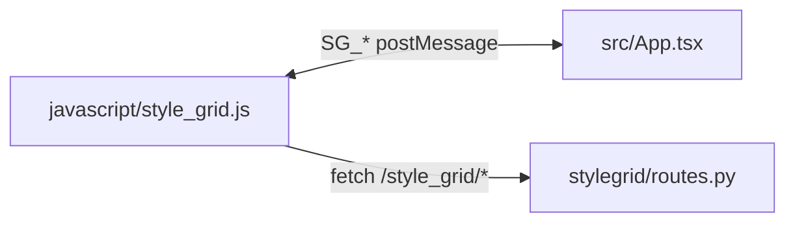

# Forgeventory UI (V2)

React + TypeScript + Vite frontend loaded by Forge inside an iframe.

## Commands

```bash
cd ui
npm ci
npm run lint
npx tsc -b
npm run build
```

`npm run build` outputs `ui/dist/`. The Forge host loads the UI with **`GET /style_grid/ui?t=<timestamp>`** (FastAPI in `stylegrid/routes.py`). **`_get_ui_html()`** in `stylegrid/routes.py` reads `ui/dist/index.html` and rewrites **each** relative `src` / `href` (`./…`) to Gradio **`/file=extensions/sd-webui-style-organizer/ui/dist/…`** with a **new** `?v=<unix time>` on every response so JS, CSS, favicon, and other linked assets stay in sync after rebuilds. The host script sets the iframe `src` in `javascript/style_grid.js`.

## Key Files

- `src/App.tsx`: iframe layout, host lifecycle, and fullscreen sizing.
- `src/components/LibraryToolbar.tsx`: primary toolbar and the shared library tools / Settings menu.
- `src/library.css`: charcoal theme, responsive layout, sidebar, and image cards; `src/index.css` defines the root font.
- `src/store/stylesStore.ts`: Zustand state, actions, `categories()`, and exported pure **`selectFilteredStyles(...)`** (filtered + deduped list for the grid — not a store method).
- `src/bridge.ts`: typed SG_* postMessage contract with host.
- `src/components/StyleGrid.tsx`: main grid; subscribes with **`useShallow`** and **`useMemo(selectFilteredStyles(...))`**; sidebar **Presets** and **LoRA** views render their dedicated card modes.
- `src/components/Sidebar.tsx`: library navigation, source-aware unique counts, category filters, drag ordering, and category actions.
- `src/components/StyleCard.tsx` / `ThumbnailPreview.tsx`: keyboard-accessible style and preset tiles with two-line names.
- `src/components/LoraCard.tsx`: portrait LoRA tiles that stream model-folder sidecars and expose prompt, Forge metadata, and local tag actions.
- `src/components/*`: other UI (sidebar, modals, etc.).

## Library layout

The default view is a continuous image grid. Settings and the toolbar's **Library tools** menu provide compact cards, optional category grouping, fullscreen, and the existing library actions. Durable preferences load from the private `data/ui_preferences.json` backend file; localStorage remains a synchronized cache and first-run migration source. Category collapse remains session-local.

All Styles and category counts match the unique visible names when All Sources is selected. Favorites and Recent also respect the selected source and search. Selecting a card shared by multiple sources still opens the source picker. Category colors appear as dots beside neutral labels; the full category remains available in its tooltip and accessible name.

Presets may include a literal `prompt` string, `negative_prompt`, `mode`, `description`, and `pinned` flag in `data/presets.json`. Pinned entries sort first in both preset lists. The Presets dialog saves the complete positive and negative prompt boxes with `mode: "scene"`; loading that card replaces both prompt boxes and clears stale Forgeventory selections. Legacy literal templates without scene mode still insert their exact text at the positive prompt selection, so the included **Starter Template** keeps its insertion behavior. Preset cards accept a manually assigned image from their right-click menu, using the same name-only thumbnail storage as uploaded style previews.

## Integration Flow



Thumbnail **images** use `GET /style_grid/thumbnail?name=…` (server resolves paths from the cached style list; see `docs/API.md`). **SD preview generation** from the host uses `POST /style_grid/thumbnail/generate` with optional JSON `source` when a specific CSV row must be targeted.
